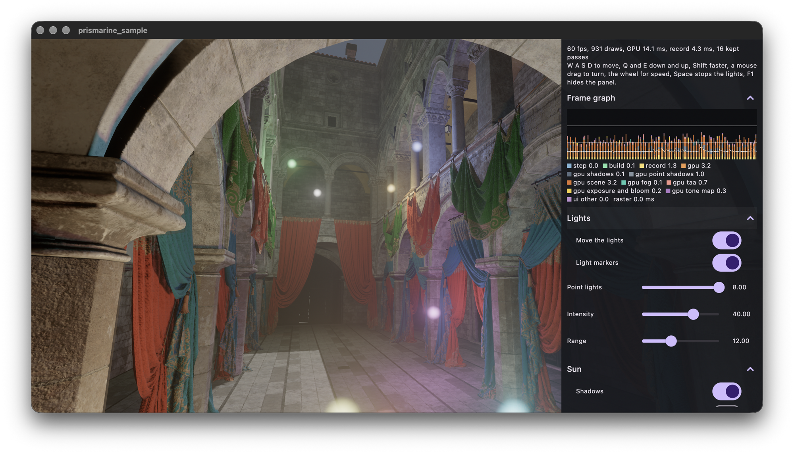

#

**prismarine** is a toolkit for making games with Flutter and Dart. It provides a renderer on Flutter GPU, a patched
Flutter engine and the parts that a real-time game needs around them, from worker threads to deterministic replay.
Every part runs on macOS, Linux and Windows.



The sample app on macOS. Sponza 2022 Scene commissioned by Frank Meinl, sponsored by Anton Kaplanyan; Intel Sponza,
[CC BY 4.0](https://creativecommons.org/licenses/by/4.0/).

## Building and running engine

To learn how to build and run sample application with prismarine engine, refer to [`Building`](docs/building.md).
With the tools installed and `bin` of your checkout on your `PATH`, one command builds and runs the sample.

```sh
prismarine run
```

## Packages

The README of each linked package gives its use, a short example and its platforms.

| Package | Contents |
|---|---|
| [`prismarine_frame`](packages/prismarine_frame/README.md) | Frame plans of passes, targets and buffers, with a codec that moves a plan between isolates |
| [`prismarine_render`](packages/prismarine_render/README.md) | The runner that records a frame plan on Flutter GPU and skips a pass whose inputs are unchanged |
| [`prismarine_pbr`](packages/prismarine_pbr/README.md) | A forward renderer of glTF scenes with metallic-roughness materials, a shadowed sun, point lights and a tone map |
| [`prismarine_scene`](packages/prismarine_scene/README.md) | A glTF importer, a scene-node layer and paced loading of assets |
| [`prismarine_shaders`](packages/prismarine_shaders/README.md) | Shader bundles for impellerc, a cache of compiled shaders and precompiled Metal libraries |
| [`prismarine_assets`](packages/prismarine_assets/README.md) | Readers and writers for glTF, KTX2 and PNG, with decoding of BC textures |
| [`prismarine_jobs`](packages/prismarine_jobs/README.md) | A pool of worker isolates with priorities and cancellation, thread roles per OS and a check of free memory |
| [`prismarine_kept`](packages/prismarine_kept/README.md) | Maps, sets and lists that keep their storage when cleared |
| [`prismarine_snap`](packages/prismarine_snap/README.md) | Binary snapshots of object graphs that preserve the references between objects |
| [`prismarine_replay`](packages/prismarine_replay/README.md) | Recording of input, deterministic replay, snapshots with a schedule, a snapshot shadow and a corpus runner |
| [`prismarine_math`](packages/prismarine_math/README.md) | Maths functions that give the same bits on every OS |
| [`prismarine_lua`](packages/prismarine_lua/README.md) | An embeddable Lua 5.2 for Dart, with double numbers by default and a float32 mode |
| [`prismarine_lua_native`](packages/prismarine_lua_native/README.md) | The stock Lua 5.2 compiler in C behind Rust, in a double and a float32 build |
| [`prismarine_audio`](packages/prismarine_audio/README.md) | Audio interfaces and an engine of events and buses |
| [`prismarine_audio_out`](packages/prismarine_audio_out/README.md) | Audio output, decoding of MP3 and Vorbis and a cache of decoded sounds |
| [`prismarine_pad`](packages/prismarine_pad/README.md) | Gamepads through SDL3 |
| [`prismarine_loop`](packages/prismarine_loop/README.md) | Frame pacing, GC pacing, a frame limiter, window focus, cursor capture and mouse look |
| [`prismarine_debug`](packages/prismarine_debug/README.md) | Frame history, a profiler per frame, a log of GPU passes, glitch capture and a debug panel |
| [`prismarine_cargo`](packages/prismarine_cargo/README.md) | A build hook that compiles the Rust crate of a package |
| [`prismarine_cook`](packages/prismarine_cook/README.md) | The cook of an app from its `prismarine.yaml`, with stamps of the inputs and a build hook for its shaders |
| [`prismarine_cli`](packages/prismarine_cli/README.md) | The `prismarine` command |

## Engine

The patched Flutter engine extends Flutter GPU with cheaper draws, retained draws, multiple render targets,
instancing, compute, texel buffers, texture arrays and 3D textures. It adds Vulkan for Linux and Windows. The Dart VM
gets collections at idle points of the frame and heap figures for the debug tools.

## Platforms

prismarine renders through Metal on macOS and through Vulkan on Linux and Windows. OpenGL ES is not supported.

| Platform | Graphics | Lowest tested version | Tested on |
|---|---|---|---|
| macOS | Metal | macOS 27.2 | Apple M2 Pro |
| Linux | Vulkan | Ubuntu 26.04 LTS | NVIDIA GeForce RTX 4060 Ti, driver 610 |
| Windows | Vulkan 1.1 | Windows 10 21H2 | Intel UHD Graphics 620 |

## Tools

| Tool | Purpose |
|---|---|
| [Allocation lint](tools/lint/README.md) | Finds code on the frame path that allocates memory |
| [Code checks](tools/lint/README.md) | Runs the analyzer, the formatters and file size checks and comments against a baseline |
| [Heap and allocation profiler](tools/profiler/README.md) | Compares heap snapshots and shows the places that allocate |
| [GPU smoke tool](tools/gpu_smoke/README.md) | Checks the Flutter GPU features of the engine on a machine |
| [prismarine command](packages/prismarine_cli/README.md) | Checks the toolchain, fetches, builds and publishes the engine, cooks, builds and runs an app on every platform |
| [Engine patches](third_party/flutter_engine/README.md) | The patches of the engine, its releases and the requirements of each platform |

## Licence

prismarine is licensed under the [BSD-3 licence](LICENSE).
<br>
Built with stochastic parrots and human.

<picture>
  <source media="(prefers-color-scheme: dark)" srcset="docs/logo/flutter/built_with_flutter_white.svg">
  
</picture>

